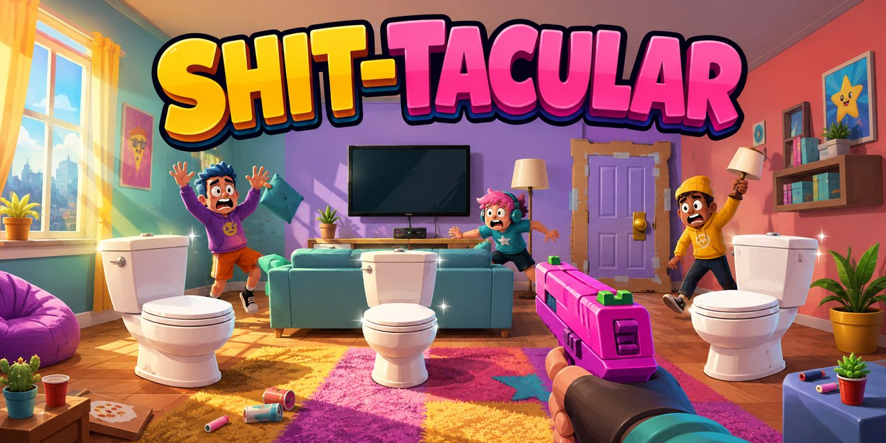

# Shit-Tacular



A first-person, last-player-standing game set inside an apartment. Battle three AI roommates in single-player, or host a direct-IP multiplayer match for 2–8 people.

**[Play Shit-Tacular on GitHub Pages](https://philiphoddinott.github.io/Shit-Tacular/)** · **[View the source on GitHub](https://github.com/PhilipHoddinott/Shit-Tacular)**

> The browser version currently supports single-player. Multiplayer uses ENet over UDP and requires the native desktop version of the game.

## How to play

Choose **basment** (the original apartment) or **2nd floor** (traced from `otherApartmentFloorPlan.jpg`) in the main menu. Each map has its own furniture, spawn points, navigation, and three toilets. Both retain the source floor-plan drawing as their floor. In multiplayer, the host's selected map is loaded on every client when the match starts.

Open `project.godot` in Godot 4.7.2, wait for the assets to finish importing, and press **F5** to play.

### Windows setup from source

1. Extract the Shit-Tacular ZIP and open the folder containing `project.godot`.
2. Download the **Windows Standard (x86_64)** ZIP from the [Godot 4.7.2 release page](https://godotengine.org/download/archive/4.7.2-stable/).
3. Extract both Godot executables into a folder named `Godot_v4.7.2-stable_win64` next to `project.godot`. Keep the regular executable and the `_console.exe` companion together.
4. Run the regular Godot executable, click **Import** in the Project Manager, and select the game's `project.godot`. Wait for the editor to finish importing, then press **F5**. After the first import, you can double-click `PLAY_GAME.bat` to launch directly.

To open the editor from PowerShell, run this from the folder containing `project.godot`.

```powershell
& ".\Godot_v4.7.2-stable_win64\Godot_v4.7.2-stable_win64.exe" --editor --path .
```

### Gameplay

Choose 1, 2, 3, or 5 **player lives** and **bot lives** independently from the main menu for single player. Every combatant begins with 100 health and respawns while lives remain. Your final death opens a loss screen with **Play Again** and **Main Menu**. Play Again preserves both life settings and the floor plan. The last player standing wins.

Players and bots regenerate **2 health per second after 5 seconds without taking damage**, up to 100 health. Taking another hit restarts the delay. Healing stops on death or when the round ends; multiplayer healing is controlled by the host.

Hold right mouse to zoom while aiming; release it to return to normal view. Rifle zoom is stronger than pistol, shotgun, or bazooka zoom, and mouse sensitivity scales with magnification. Original synthesized spatial effects cover gunfire, impacts, explosions, toilet flushes, weapon rewards, and the rainbow power-up. Sounds are shared with multiplayer peers and require no downloads.

Confirmed hits flash a white hit marker; lethal hits flash gold. Incoming damage flashes the screen edges and shows the attack direction. Weapons have centered aiming sights, subtle movement sway, and recoil. Bots patrol, investigate nearby gunshots, pursue the last place they saw an opponent, and seek reachable cover at low health. Navigation is checked against walls and furniture on the selected map, and defeated bots animate a fall before respawning or remaining eliminated.

Your first two unique toilet flushes each award a random pistol, shotgun, rifle, or bazooka. Flush all three to trigger **TRIPLE-SHIT!** and equip the glowing rainbow rifle, which deals 40 damage per bullet. After that, flushing any toilet swaps your current gun for a random standard weapon. Your weapon and toilet progress carry through respawns.

## Single-player polish

- **Pause and settings:** Escape opens a real pause menu with Resume, Restart, and Main Menu. Movement, rockets, regeneration, and bot respawn timers freeze. Settings are also available from the main menu: mouse sensitivity, field of view, independent music/SFX volume, and music on/off. Preferences save locally and can be reset to defaults.
- **Rockets:** The bazooka launches a visible rocket with a smoke trail and a cartoon “KA-POOP!” explosion. Direct hits do 90 damage; splash falls off from the target's body center and is blocked by walls. The shooter remains immune to their own blast. Walls also block toilet/chair interactions.
- **Roommates:** Choose Easy, Normal, or Hard reaction speed, accuracy, and firing cadence. Bots strafe safely and sometimes visit reachable toilets to earn the same weapon rewards as you. Their toilet progress and weapons survive respawning. Respawns prefer covered, distant locations; a pulsing cyan ring marks 1.2 seconds of protection during which a bot cannot shoot or take damage.
- **Round progress:** Numbered gold toilet markers turn green after your flushes. The HUD shows remaining enemy lives and elapsed time. Win/loss screens show kills, accuracy, time, and toilets flushed; fastest wins are saved separately for each map/difficulty/bot-lives combination. Accuracy counts trigger pulls that damage an opponent, so multiple shotgun pellets or a rocket multikill count as one successful shot.
- **Apartment:** Added compact cover cabinets, silly signs and trophies, cartoon bot faces, and decor that wobbles near explosions. The floor-plan drawing remains the default. Uncheck **Floor-plan drawing on floor** in Settings for wood/tile finishes; the minimap still shows the plan.

The pause menu, difficulty settings, and personal records apply to single player.

## Controls

“Flush Funk,” generated locally with ACE-Step, plays quietly across menus and matches.
Press **M** to pause or resume the music independently of game sound effects.

The bottom-left minimap shows the selected floor plan. Your cyan arrow indicates your position and facing direction; red dots show all other living players or bots, including through walls. Eliminated combatants disappear, and respawning bots reappear. In single player, gold numbered toilet markers turn green as you flush them.

| Control | Action |
| --- | --- |
| `WASD` | Move |
| `Shift` | Sprint |
| `Space` | Jump |
| Left mouse | Fire the equipped weapon |
| Hold right mouse | Aim / zoom (stronger magnification for rifles) |
| `B` | Swing the knife at close range |
| `E` | Flush a toilet, sit in a dining chair, or stand up |
| `Escape` | Pause / resume single player; release or recapture the mouse in multiplayer |
| `R` | Restart after the round ends |

## Multiplayer playtest

All players must use the same native version of the game. One player hosts the match and shares the address shown in the lobby with everyone else.

### Host a match

1. Open **Multiplayer** and enter your player name.
2. Set the lobby capacity, map, and **1–99 lives per player**. Choose **Free-for-All** to compete or **Co-op vs Bots** to team up against three bots.
3. For an internet match, leave **Automatically open the UDP port** enabled.
4. Select **Create Lobby**.
5. Use **Copy LAN** for players on the same network, or **Copy Internet** for remote players, then send the copied `IP:port` address to them.
6. Select **Start Match** whenever you're ready. The game starts with the players already in the lobby. If you're alone, **Start with Bots** puts you against three bots using the selected map and lives.

In **Co-op vs Bots**, everyone on the human team shares the same win or loss. Both sides use the host's lives setting, and friendly fire is off. Your team wins when the bots run out of lives. Green dots on the minimap show teammates.

### Join a match

1. Open **Multiplayer** and enter your player name.
2. Paste the host's complete `IP:port` address into **Host IP**.
3. Select **Join** and wait in the lobby for the host to start the match.

### Play a rematch

Players respawn at full health while they have lives left. Eliminated players stay connected until everyone sees the results. The scoreboard shows each player's kills, deaths, damage dealt, shots, firearm accuracy, and rewarded flushes. The host can change the mode, map, and lives on that screen, then select **Play Again** to start with everyone still connected. If only the host remains, **Play with Bots** starts a bot match. Select **Main Menu** to leave.

### Connection notes

- Multiplayer uses ENet over UDP. The default port is `7000`.
- **Copy LAN** is for computers on the same Wi-Fi or wired network.
- **Copy Internet** becomes available after the host's router accepts the automatic UPnP port mapping.
- If automatic setup fails, allow the game through the host computer's firewall and manually forward the selected **UDP** port to that computer.
- Some double-NAT and carrier-grade NAT connections cannot accept direct connections. Those networks will need a VPN-style workaround or the planned relay service.

The host is authoritative: clients send their controls to the host, and the host resolves movement, shots, damage, lives, respawns, and the winner. Game state is synchronized back to clients 20 times per second.

## Playtest logs

The Windows build keeps the current session log and up to ten older logs. They include Godot and system information along with important game, lobby, connection, UPnP, death, respawn, and round events.

After a crash or connection problem:

1. Restart the game.
2. Select **Open Crash Logs** on the main menu.
3. Send the newest `.log` file to the developer with a short description of what happened.

If the game fails before reaching the menu, run `PLAY_GAME_DIAGNOSTIC.bat` and send `startup-diagnostic.log` from `%APPDATA%\Godot\app_userdata\Shit-Tacular\logs`. If the launcher says it could not write the log, send the error shown in the console.

Logs may contain player names and network addresses, so review them before sharing outside the playtest group. Native engine crashes may have a limited backtrace without matching debug symbols, but script errors and the gameplay or network events leading up to the failure should still be recorded.

## Project notes

The first Blender graphics pass adds a rounded graphite/coral pistol with padded gloves, visible sights, equip motion, and sliding recoil. It renders separately from the apartment so nearby walls cannot cut through the hands. The living-room sofa and coffee table now use rounded Blender meshes with cushions, piping, pillows, and tapered feet. Lighting has gentler ceiling highlights, shadowed window light, and softer wood grain. Collision geometry and weapon damage are preserved.

Editable `.blend` scenes and rebuilding instructions are in `art_source/README.md`. Godot uses the exported GLB assets; Blender is only needed to edit or rebuild them. For in-game screenshots and weapon-switch cleanup checks, run `godot --path . --script res://tools/capture_graphics.gd -- --qa-graphics`.

The apartment uses a doubled horizontal footprint for wider rooms and less crowded firefights. The supplied floor-plan PNG is the default floor. It includes room-specific wall colors, wall panels and bathroom wall tiles, baseboards, ceiling trim, doorway casings, ceiling fixtures, fabric upholstery, detailed cabinets, furniture and small decor, fake window light, a wall-mounted television, four sittable dining chairs, and a very judgmental bathroom mirror. Furniture and wall surface textures are generated deterministically in Godot, with mipmaps, and require no asset downloads. Use `--qa-floorplan-capture` for the overhead layout check.

The GitHub-ready 1280×640 social preview is stored at `assets/github/social-preview.jpg`, with its full-resolution generated source beside it.

## Roadmap

1. Playtest and tune the host-authoritative ENet multiplayer prototype.
2. Improve art, sound, bot navigation, and round presentation.
3. Add room codes, NAT traversal/relay support, and clearer connection diagnostics.
4. Package Windows builds for wider playtesting.

## Single-player checks

With the Godot executable on your PATH, run these from the project directory. They do not connect to multiplayer services:

```text
godot --headless --path . --quit-after 1800 -- --qa-singleplayer
godot --headless --path . --quit-after 1800 -- --qa-smoke
godot --headless --path . --quit-after 1800 -- --qa-maps
godot --headless --path . --quit-after 1800 -- --qa-combat
godot --headless --path . --script res://tools/qa_rockets.gd --quit-after 1800
godot --headless --path . --script res://tools/test_bot_singleplayer.gd --quit-after 1800
godot --headless --path . --script res://tools/test_pause_settings.gd --quit-after 3000
godot --headless --path . --script res://tools/test_round_results.gd --quit-after 1800 -- --qa-results-marker
```

Remove `--headless` from the pause-settings test to also check captured-mouse sensitivity and aiming. Rendered menu, pause, floor, bathroom, and results captures can be generated with `godot --path . --script res://tools/capture_singleplayer.gd -- --qa-polish`; images are saved under the ignored `artifacts/` directory. QA runs do not save personal-best records.
